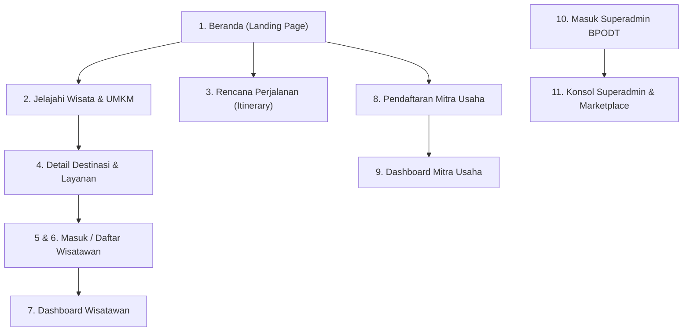

# PRODUCT REQUIREMENTS DOCUMENT (PRD)
## SINDAR TOBA — Kemewahan Budaya & Eksplorasi Danau Toba
*Ekosistem Digital Pariwisata Kaldera UNESCO & Marketplace Pemberdayaan UMKM Kawasan Danau Toba*

---

## 1. Executive Summary & Visi Produk

### 1.1 Ringkasan Produk
**SINDAR TOBA** (*"Sindar"* dalam bahasa Batak bermakna cahaya / sinar kemilau) adalah platform web pariwisata berkelas dunia (*high-end editorial travel ecosystem*) yang menggabungkan direktori wisata terkurasi, sistem reservasi pengalaman otentik, marketplace produk UMKM unggulan (kriya gorga, ulos, kopi lintong, kuliner andaliman), perencana perjalanan cerdas (*smart travel itinerary*), serta portal kemitraan dan pusat kendali terpadu untuk pengelola kawasan (BPODT - Badan Pelaksana Otorita Danau Toba).

### 1.2 Tujuan Utama (Goals)
1. **Mengangkat Citra Destinasi Kelas Dunia**: Menampilkan kekayaan alam kaldera vulkanik dan warisan adat Batak dalam visual mewah bergaya editorial (*Aman-style aesthetic*).
2. **Pemberdayaan Ekonomi Lokal & UMKM**: Memberikan wadah digital langsung bagi pegiat wisata lokal, homestay tradisional, seniman tenun ulos, dan perajin kriya untuk menjangkau wisatawan tanpa perantara berlebih.
3. **End-to-End Traveler Journey**: Memudahkan wisatawan merencanakan perjalanan, memesan paket wisata/penginapan secara aman, hingga menyimpan e-tiket/voucher dalam satu dashboard.
4. **Tata Kelola Ekosistem Transparan**: Menyediakan sistem verifikasi mitra, analitik transaksi, dan pemantauan mutu layanan terpadu bagi administrator dan pemangku kepentingan.

---

## 2. Target Pengguna & Personas

| Persona | Profil & Karakteristik | Kebutuhan Utama |
| :--- | :--- | :--- |
| **Wisatawan Nusantara / Mancanegara (Traveler)** | Penggemar wisata alam, budaya, dan pengalaman eksklusif (*experiential traveler*). Mengutamakan keaslian (*authenticity*), kenyamanan, dan kurasi terpercaya. | Eksplorasi destinasi, pencarian rekomendasi rute, pemesanan paket wisata/homestay secara instan, panduan etika budaya, dan akses e-tiket. |
| **Mitra Usaha Lokal (Merchant / Vendor)** | Pemilik homestay, pemandu wisata adat, pengrajin ulos, petani kopi, dan pelaku UMKM kuliner lokal di 8 kabupaten sekitar Danau Toba. | Registrasi mudah, pendaftaran produk/layanan, penerimaan reservasi, pemantauan omzet, pencairan dana (*payout*), dan promosi. |
| **Superadmin / BPODT (Platform Governance)** | Administrator platform dan perwakilan badan otorita pariwisata Danau Toba. | Verifikasi legalitas mitra, monitoring transaksi & GMV, moderasi konten, manajemen komisi/kategori, dan analitik ekosistem. |

---

## 3. Sistem Desain & Visual Identity (Berdasarkan Spesifikasi Figma)

### 3.1 Tipografi
- **Headline / Display Font**: `Cinzel` (Bold & Regular) — Memberikan aura kemewahan, keagungan situs bersejarah dunia, dan presisi monumen kaldera.
- **Editorial Sub-Headings & Quotes**: `Newsreader` (Light & Italic) — Digunakan untuk sentuhan editorial naratif dan aksen puitis budaya.
- **Body & Interface Font**: `Plus Jakarta Sans` (Regular, Medium, SemiBold, Bold) — Modern, ergonomis, sangat terbaca di layar desktop maupun mobile.

### 3.2 Palet Warna & Token Desain
- **Primary Lake Emerald**: `#1A3A34` (Warna hijau kaldera dan kedalaman air Danau Toba — warna dominan navigasi, tombol utama, dan header).
- **Cultural Gold / Amber Accent**: `#C29D59` & `#B8653A` (Representasi benang emas tenun ulos, rempah, dan pencahayaan matahari terbit).
- **Mist & Paper Backgrounds**: `#F8F6F2`, `#F2EDE5` (Warna kanvas lembut ramah mata yang memberikan rasa kertas editorial premium).
- **Border & Dividers**: `#E8E2D9` (Garis halus pembatas struktural layout).
- **Slate & Muted Text**: `#575e5b`, `#2C3531` (Keterbacaan tinggi dengan kontras lembut).
- **Purity White**: `#FFFFFF` (Kartu konten, modal, dan elemen permukaan).

### 3.3 Aksen Visual Khas
- **Motif Gorga Batak Geometric**: Watermark dan border geometris batak khas (Simataniari / Paung) yang disematkan secara subtil sebagai aksen identitas budaya.
- **Glassmorphism / Frosted Scrim**: `backdrop-blur-[24px]` dengan latar semitransparan untuk navigasi mengambang dan widget pencarian.
- **Pill Badges & Architectural Cards**: Sudut melengkung halus (*rounded-full* dan *rounded-2xl*) memberikan impresi modern dan elegan.

---

## 4. Arsitektur Informasi & Spesifikasi 11 Layar Utama

---

### 4.1 Layar 1: SINDAR TOBA - Landing Page (`1:85483`)
* **Header / Sticky Navigation (`1:86439`)**:
  - Logo Sindar Toba dengan aksen lencana Gorga Batak.
  - Subteks: *"KALDERA UNESCO • WARISAN BATAK"*.
  - Menu: Jelajahi, Pengalaman, Rencana Perjalanan, Untuk Mitra.
  - Utility Bar: Selector mata uang/wilayah (`IDR · Danau Toba`), Tombol Bantuan, Tombol Masuk, dan Akses Profil Akun Tamu.
* **Hero Section Atmosphere (`1:85486`)**:
  - Latar belakang foto kabut kaldera dengan multilayer gradient scrim overlay dan watermark Gorga SVG.
  - Cultural Geo-Tag: *"KALDERA VULKANIK UNESCO GLOBAL GEOPARK"*.
  - Headline: *"Temukan Keindahan dan Pengalaman Luhur Danau Toba"*.
  - Floating Architectural Search Bar: Filter Kawasan Destinasi (Samosir, Parapat, Balige, Humbahas, dll.) + Kategori Pengalaman + Tombol Eksplorasi.
  - Quick Trending Pills: Bukit Holbung, Desa Tomok, Kopi Lintong, Homestay Batak, Kapal Feri Ajibata.
* **Explore Categories (`1:86249`)**:
  - 6 Kartu Kategori: Destinasi Alam Kaldera, Warisan & Budaya Batak, Penginapan Tradisional & Villa, Kuliner Khas & Rempah Toba, Paket Wisata Terkurasi, Transportasi Danau.
* **Popular Destinations Grid (`1:85564`)**:
  - Filter segmented bar: Semua Kawasan, Pulau Samosir, Parapat & Toba, Balige, Humbang Hasundutan.
  - Kartu destinasi editorial dilengkapi label harga, rating ulasan, lokasi geosite, dan tombol reservasi.
* **Local Experiences (`1:85744`)**:
  - Penekanan aktivitas langsung: Workshop Menenun Ulos bersama Maeta, Wisata Memetik Kopi Arabika Lintong, Tur Perahu Kayu Tradisional Solu Bolon.
* **Local Culinary & MSMEs (`1:85892`)**:
  - Etalase produk UMKM lokal: Kopi Lintong Specialty, Kain Tenun Ulos Harungguan, Andaliman Bubuk Organik, Kerajinan Ukir Kayu Gorga.
* **Travel Inspiration & Curated Itinerary (`1:86025`)**:
  - Pratinjau rencana perjalanan 3D2N dan 2D1N beserta estimasi budget dan highlight rute.
* **Partner Invitation Banner (`1:86161`)**:
  - Call-to-Action untuk pelaku usaha lokal Danau Toba mendaftarkan properti/layanan mereka.
* **Trust & Impact Statistics (`1:86211`)**:
  - Metrik dampak sosial ekonomi: 150+ Mitra UMKM Terberdayakan, 45+ Destinasi & Geosite Resmi, 98% Kepuasan Wisatawan.
* **Footer Editorial (`1:86420`)**:
  - Navigasi lengkap, tautan sosial media, info kontak, legalitas, serta pengakuan kemitraan BPODT & Kemenparekraf.

---

### 4.2 Layar 2: Jelajahi Wisata & UMKM Danau Toba (`1:86475`)
* **Page Header & Narrative Hero (`1:86478`)**: Judul katalog dan deskripsi panduan eksplorasi geosite.
* **Category Tabs & Filter Engine (`1:87006`)**: Tab kategori utama yang dinamis.
* **Search & Filter Toolbar (`1:86524`)**:
  - Filter pencarian kata kunci multi-parameter.
  - Dropdown filter kabupaten/wilayah (Samosir, Toba, Tapanuli Utara, Humbang Hasundutan, Simalungun, Karo, Dairi, Pakpak Bharat).
  - Filter rentang harga (IDR) dan rating bintang (4.5+).
  - Pengurutan: Terpopuler, Harga Terendah, Terbaru, Rekomendasi Editorial.
* **Main Listing Grid 3 Kolom (`1:86604`)**:
  - Kartu produk/destinasi beresolusi tinggi dengan badge verifikasi geosite resmi.
  - Tag kategori, nama lokasi, harga mulai dari, dan CTA *"Lihat Detail"*.
* **Interactive Discovery Map Preview Banner (`1:86957`)**:
  - Integrasi visual peta interaktif kawasan kaldera dengan pin lokasi sebaran geosite & UMKM.
* **Curated Concierge CTA (`1:86983`)**: Layanan konsultasi perjalanan langsung via WhatsApp Concierge.
* **Pagination Controls (`1:86930`)**: Navigasi halaman katalog yang terstruktur.

---

### 4.3 Layar 3: Rencana Perjalanan / Travel Planner (`1:87159`)
* **Step Header Navigation (`1:87164`)**: Indikator langkah perancangan rute.
* **Preferences Customizer Module (`1:87200`)**:
  - Pilihan durasi liburan (1 Hari, 2D1N, 3D2N, 4D3N+).
  - Gaya perjalanan (*Paces & Vibe*): Wisata Budaya & Sejarah, Petualangan Alam, Relaksasi & Wellness, Wisata Kuliner.
  - Jumlah rombongan: Solo traveler, Pasangan, Keluarga, Grup besar.
  - Anggaran perjalanan: Backpacker, Standar Nyaman, Kemewahan Eksklusif (*Luxury*).
* **Two-Column Main Schedule & Cost Estimator (`1:87366`)**:
  - **Kolom Kiri (Interactive Timeline)**: Rincian hari per hari (Day 1: Penjemputan Silangit & Sunset Holbung; Day 2: Danau & Desa Adat; Day 3: Belanja Ulos & Kuliner).
  - **Kolom Kanan (Sticky Cost Card)**: Rincian akumulasi biaya tiket geosite, sewa kendaraan/kapal, pemandu lokal, dan akomodasi. Tombol *"Simpan Rencana"* dan *"Pesan Semua Paket"*.
* **Editorial FAQ & Smart Travel Tips (`1:87666`)**:
  - Panduan cuaca kaldera, etika berkunjung ke Huta Batak, jadwal kapal penyeberangan Danau Toba.

---

### 4.4 Layar 4: Detail Destinasi & Layanan Wisata (`1:87820`)
* **Hero Image Mosaic Gallery**: Galeri foto editorial resolusi tinggi dengan tampilan grid mosaik.
* **Header & Geotag**: Nama destinasi, lencana warisan budaya, rating bintang terverifikasi, dan breadcrumbs navigasi.
* **Interactive Segmented Tabs (`1:87945`)**:
  - *Tentang & Kisah* (Narasi sejarah geologis/budaya).
  - *Fasilitas & Layanan* (Toilet bersih, pemandu lokal berbahasa Inggris/Batak, wifi, musholla, parkir).
  - *Paket & Aktivitas* (Opsi paket reguler vs paket VIP private guide).
  - *Lokasi & Aksesibilitas* (Peta dan panduan rute transportasi).
  - *Ulasan Wisatawan*.
* **Two-Column Layout & Sticky Booking Card (`1:87963`)**:
  - **Konten Utama (Kiri)**: Artikel naratif mendalam, profil mitra pengelola/tuan rumah lokal, serta ketentuan pembatalan.
  - **Sticky Booking Widget (Kanan)**:
    - Pemilih tanggal kunjungan (*Date Picker*).
    - Pemilih jumlah tamu / tiket.
    - Opsi add-on (Pemandu adat, sewa pakaian tradisional Batak, makan siang lokal).
    - Kalkulasi total instan + Jaminan garansi keamanan transaksi.
    - Tombol aksi utama: *"Reservasi Sekarang"*.
* **Verified Traveler Reviews (`1:88332`)**: Rincian rating rata-rata, testimoni teks dan foto dari wisatawan terverifikasi.
* **Nearby Attractions (`1:88500`)**: Rekomendasi tempat wisata dan kedai kuliner di sekitar radius 5–10 km.

---

### 4.5 Layar 5 & 6: Autentikasi Wisatawan (`1:88682` & `1:88988`)
* **Pendaftaran Akun Wisatawan (`1:88682`)**:
  - Input: Nama Lengkap, Alamat Email, Nomor WhatsApp aktif (untuk notifikasi voucher otomatis), Kata Sandi.
  - Tombol Quick SSO: *Daftar dengan Google*.
  - Checkbox persetujuan syarat & ketentuan ekosistem pariwisata.
* **Masuk Akun Wisatawan (`1:88988`)**:
  - Input: Email / No. WhatsApp dan Password.
  - Opsi *Ingat Saya* dan tautan *Lupa Kata Sandi*.
  - Quick SSO Google.
  - Visual pendukung: Split-screen dengan foto megah lanskap Danau Toba dan quote kearifan lokal Batak.

---

### 4.6 Layar 7: Dashboard Wisatawan (`1:89279`)
* **Welcome Header & Status Akun**: Sapaan personal kepada wisatawan, foto profil, dan status membership.
* **Tab Navigasi Dashboard**:
  - **Pesanan & Tiket Aktif**: Kartu booking memuat QR Code E-Tiket untuk discan di lokasi geosite/hotel, kontak WhatsApp mitra, dan tombol unduh PDF invoice.
  - **Rencana Perjalanan Saya**: Daftar itinerary yang telah disusun via travel planner.
  - **Destinasi & Produk Favorit (Wishlist)**: Koleksi tersimpan untuk referensi perjalanan mendatang.
  - **Riwayat Kunjungan & Ulasan**: Form pengisian rating dan review untuk pengalaman yang telah selesai.

---

### 4.7 Layar 8: Pendaftaran Mitra Usaha (`1:90738`)
* **Alur Multi-Step Onboarding Mitra**:
  - **Langkah 1 (Profil Bisnis)**: Nama Usaha/Kelompok Sadar Wisata (Pokdarwis), Kategori Layanan (Homestay, Tur & Pemandu, Kuliner & Kafe, Kerajinan & Kriya, Transportasi Kapal/Mobil).
  - **Langkah 2 (Wilayah Operasional & Legalitas)**: Kabupaten domisili di sekeliling kaldera, alamat lengkap, NIB / Surat Keterangan Usaha Desa (opsional untuk UMKM mikro), KTP Penanggung Jawab.
  - **Langkah 3 (Akun Finansial)**: Nama Bank, Nomor Rekening, dan Nama Pemilik untuk pencairan otomatis hasil penjualan tiket/produk.
  - **Langkah 4 (Foto & Portofolio)**: Unggah foto produk/properti, deskripsi singkat, dan tarif acuan.
* **Pakta Integritas Layanan Wisata**: Komitmen standar kebersihan, keramahan (*Hospitality Batak*), dan harga transparan bebas calo.

---

### 4.8 Layar 9: Dashboard Mitra Usaha (`1:89849`)
* **Ringkasan Kinerja Usaha**:
  - Kartu Metrik: Total Omzet Bulan Ini, Pesanan Masuk Baru, Total Pengunjung, Skor Rating Ulasan Pelanggan.
  - Grafik Analisis Kinerja: Tren kunjungan dan pemasukan per minggu/bulan.
* **Kelola Destinasi & Produk Wisata (Listing Manager) (`1:90096`)**:
  - Tabel katalog layanan milik mitra: Status (Aktif/Nonaktif), Kuota harian tersedia, Harga tiket/produk, Tombol *Edit* dan *Tambah Layanan Baru*.
* **Kelola Reservasi & Pemesanan (`1:90342`)**:
  - Daftar tamu yang akan datang: Jadwal kedatangan, status pembayaran (Lunas/Menunggu Check-in), tombol konfirmasi kehadiran.
* **Pencairan Dana (Settlement)**: Saldo siap tarik, riwayat pencairan, dan estimasi waktu transfer ke rekening mitra.

---

### 4.9 Layar 10 & 11: Portal Superadmin BPODT (`1:91195` & `1:92254`)
* **Login Konsol Superadmin BPODT (`1:92254`)**:
  - Autentikasi aman khusus staf pengelola BPODT/SINDAR TOBA dengan proteksi 2-Factor Authentication (OTP).
* **Pusat Kendali Administrasi & Ekosistem (`1:91195`)**:
  - **Operational Control Bar & 7 Responsive Metric Cards**:
    1. Total Gross Merchandise Value (GMV).
    2. Total Transaksi Berhasil.
    3. Jumlah Mitra Terverifikasi.
    4. Total Wisatawan Terdaftar.
    5. Pendapatan Platform / Dana Retribusi Kawasan.
    6. Tiket Laporan / Pengaduan Aktif.
    7. Destinasi & Geosite Aktif.
  - **Critical Action Table: Verifikasi Mitra Baru (`1:91574`)**:
    - Antrean pendaftaran mitra: Preview dokumen legalitas, foto tempat usaha, tombol *Setujui (Approve)*, *Tolak (Reject)*, atau *Minta Revisi Dokumen*.
  - **Tabel Transaksi & Pemantauan Arus Kas (`1:91785`)**:
    - Log transaksi real-time di seluruh ekosistem dengan status payment gateway (Escrow hold, Success, Refund).
  - **Modular Admin Quick-Controls (`1:91992`)**:
    - Pengaturan Kategori Pariwisata, Banner Pengumuman Siaga Cuaca Kaldera, dan Export Laporan Resmi (Excel/PDF) untuk rapat dinas pemerintah daerah.

---

## 5. Kebutuhan Fungsional & Modul Sistem

### 5.1 Modul Pencarian & Filter Cerdas
- Pencarian kata kunci dengan toleransi ejaan (*fuzzy search*).
- Filter berlapis: Wilayah (8 Kabupaten), Kategori Usaha, Kisaran Harga, Rating, Ketersediaan Tanggal.

### 5.2 Modul Booking & Reservasi
- Pemilihan tanggal interaktif dengan deteksi batas kuota harian.
- Penghitungan harga otomatis (Tiket dasar + Opsi tambahan + Biaya layanan).
- Integrasi Payment Gateway (QRIS, Virtual Account BCA/Mandiri/BRI, E-Wallet GoPay/OVO, Kartu Kredit).
- Penerbitan E-Voucher instan dengan QR Code unik dan otomatis dikirimkan ke WhatsApp & Email wisatawan.

### 5.3 Modul Itinerary Planner
- Generator rencana liburan berdasarkan preferensi durasi, budget, dan minat wisata.
- Fitur drag-and-drop urutan destinasi serta estimasi waktu tempuh antar geosite.
- Simpan ke akun pribadi atau unduh sebagai rangkuman PDF ringkas.

### 5.4 Modul Keamanan & Hak Akses (Role-Based Access Control)
- **Guest**: Melihat katalog, membaca artikel, menggunakan itinerary planner, simulasi booking.
- **Wisatawan**: Melakukan pembayaran, menyimpan wishlist, melihat e-tiket, memberi ulasan.
- **Mitra Usaha**: Mengelola listing, melihat pemesanan tamu, menarik saldo pendapatan.
- **Superadmin**: Mengesahkan akun mitra, memoderasi ulasan, melihat laporan finansial menyeluruh, mengelola master data wilayah dan kategori.

---

## 6. Rekomendasi Arsitektur Teknologi

| Layer | Teknologi yang Direkomendasikan | Alasan Pemilihan |
| :--- | :--- | :--- |
| **Framework Frontend** | **Next.js 14+ (App Router) + React 18 / 19** | Mendukung Server-Side Rendering (SSR) untuk SEO pariwisata yang sangat baik, performa rendering tinggi, dan integrasi TypeScript yang solid. |
| **Styling & UI** | **Tailwind CSS + Headless UI / Radix UI** | Menerjemahkan spesifikasi Figma secara presisi, ringan, responsive, dan mudah dikombinasikan dengan sistem warna token kustom. |
| **Ikonografi & Aset** | **Lucide React + SVG Gorga Kustom** | Ikon clean dan modern, dipadukan dengan vektor ornamen Batak beresolusi tinggi. |
| **Database & Auth** | **Supabase (PostgreSQL) / Prisma ORM** | Row Level Security (RLS) bawaan untuk keamanan data mitra & admin, otentikasi Google OAuth & Email instan, serta integrasi storage gambar. |
| **Payment Gateway** | **Midtrans / Xendit (Snap Integration)** | Mendukung seluruh kanal pembayaran populer Indonesia (QRIS, Transfer Bank lokal, Indomaret/Alfamart untuk wisatawan non-bank). |
| **Notifikasi WhatsApp** | **Fonnte / Wablas API** | Mengirimkan E-Tiket dan pengingat jadwal penjemputan/check-in langsung ke nomor WhatsApp wisatawan Indonesia. |

---

## 7. Rencana Tahapan Pengembangan (Roadmap)

### Fase 1: Desain ke Kode & Halaman Publik (Minggu 1 - 2)
- Setup project repository (Next.js + TypeScript + Tailwind CSS).
- Konfigurasi font (`Cinzel`, `Newsreader`, `Plus Jakarta Sans`) dan palet warna Batak Gorga.
- Pembuatan komponen global: Header navigasi responsif, Footer editorial, Card komponen.
- Implementasi visual presisi: **Beranda**, **Katalog Jelajahi**, dan **Detail Destinasi**.

### Fase 2: Perencana Perjalanan & Autentikasi (Minggu 3)
- Implementasi logika kalkulator dan timeline **Travel Planner**.
- Pembuatan antarmuka **Masuk & Daftar Wisatawan** dengan integrasi autentikasi (NextAuth / Supabase Auth).
- Halaman **Dashboard Wisatawan** beserta komponen visual E-Tiket QR.

### Fase 3: Portal Kemitraan & Integrasi Transaksi (Minggu 4 - 5)
- Pembuatan form multi-step **Pendaftaran Mitra Usaha**.
- Halaman **Dashboard Mitra Usaha** (CRUD Listing dan kalender reservasi).
- Integrasi sandbox Payment Gateway untuk alur pembayaran pemesanan wisata.

### Fase 4: Konsol Superadmin BPODT & Finalisasi (Minggu 6)
- Implementasi **Konsol Superadmin BPODT** (Tabel verifikasi pendaftaran mitra & analitik GMV).
- Testing performa, responsiveness mobile/tablet, dan audit aksesibilitas.
- Deployment ke server staging/production (Vercel / Cloud).

---
*Dokumen ini disusun sebagai cetak biru resmi pengembangan website SINDAR TOBA sesuai dengan file desain Figma yang telah diverifikasi.*
